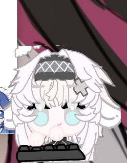

# 小灰桌宠

一个常驻在桌面右下角的小东西。你敲键盘、动鼠标，她会跟着有反应，头顶会冒出一朵云，显示你刚按了哪个键。

## 下载

到 [Releases](https://github.com/yzt1123/xiaohui-desktop-pet/releases/latest) 里下载 `xiaohui-pet-v1.0.zip`（约 38 MB），解压到任意一个文件夹（建议桌面或 D 盘，别放 `C:\Program Files`），双击里面的 `小灰桌宠.exe` 就能用。

不需要装 Python，也不需要装任何运行库。

> 第一次运行 Windows SmartScreen 会拦一下，点「更多信息」→「仍要运行」就好。没买数字签名，这不是病毒。
>
> `小灰桌宠.exe` 必须和 `_internal` 文件夹放在一起，别只把 exe 拖出来，会报 Failed to load Python DLL。

## 按键

表情键都是 Alt 加一个键。按一下换脸，然后一直保持，不会自己变回去。想收回表情，再按一次同一个组合，或者点她一下。

| 组合键 | 表情 | 说明 |
| --- | --- | --- |
| Alt + J | 默认 | 平时的样子，趴在键盘上 |
| Alt + 7 | 忧郁 | 抱着笔记本发呆 |
| Alt + 8 | 大笑 | 有人摸她头 |
| Alt + 9 | 哭 | 眼泪哗哗的 |
| Alt + 0 | 生气 | 敲键盘敲到冒青筋 |
| Alt + - | 无语 | 眼睛里转圈 |
| Alt + 1 | 墨镜 | 戴上墨镜 |
| Alt + 2 | 睡觉 | 靠着手机睡着 |
| Alt + 3 | 馋 | 举着刀叉 |
| Alt + 4 | Bug | 头上有一只蟑螂 |

> 浏览器里 Alt + 数字默认是切换标签页，会跟着一起触发。觉得碍事就改 `mapping.json` 里的组合。

## 她还会做什么

- 头顶云朵显示你刚按的键；组合键会显示成 `Alt+9` 这样
- 一直快打（每秒 8 下以上、持续 1 秒）她会短暂皱一下眉，然后自己恢复
- 鼠标移到哪边，她的头就往哪边偏一点
- 放着不管九十秒，她会睡着；一动键盘就醒
- 点不到她身上的地方会直接穿过去，不挡鼠标，也不抢输入焦点
- 同一个程序只会开一个，双击两次不会出现两只
- 右键菜单：换表情、改大小、换气泡样式（白框 / 云朵 / 深色 / 无框）、回到右下角、退出

## 关于

- 用 Python + PySide6 写的，源码在 `src/`
- 不是 Live2D。她是一张静帧切成 50 条横带做弯折，只能整体倾斜和呼吸，四肢不独立，眼睛不会自己眨
- 人物形象来自原作者发布的 PNGTuber 素材，**版权归原作者**。这个项目只做了非商业的桌宠化封装，请勿商用，也不要二次分发素材本身
- 完整使用说明在压缩包里的 `使用说明.pdf`
